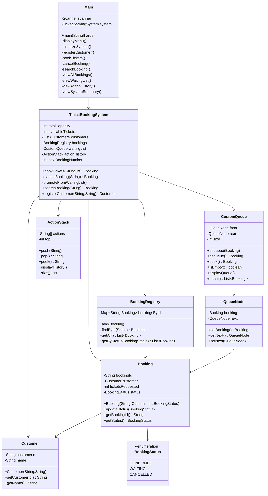

# System Design: Ticket Booking Queue System Using Java and DSA

## 1. System Architecture

The system follows a layered architecture separating concerns for better maintainability:

```
┌─────────────────────────────────────────────────────────────────┐
│                    PRESENTATION LAYER                            │
│                        Main.java (Menu)                          │
└─────────────────────────────────────────────────────────────────┘
                              │
                              ▼
┌─────────────────────────────────────────────────────────────────┐
│                    BUSINESS LOGIC LAYER                          │
│                  TicketBookingSystem.java                        │
│        (Inventory, Booking, Cancellation, Promotion)             │
└─────────────────────────────────────────────────────────────────┘
                              │
                ┌─────────────┼─────────────┐
                ▼             ▼             ▼
            ┌───────┐   ┌─────────┐   ┌───────────┐
            │ Models │   │   DSA   │   │  Registry   │
            │Customer│   │CustomQueue│  │BookingRegistry│
            │Booking │   │ActionStack│  │             │
            │Status  │   │QueueNode │  │             │
            └───────┘   └─────────┘   └───────────┘
```

## 2. Class Responsibilities

| Class | Type | Responsibility |
|---|---|---|
| `Main.java` | Driver Class | Menu display, user input, input validation, calling engine methods |
| `TicketBookingSystem.java` | Engine Class | Core logic - inventory, booking, cancellation, promotion, reports |
| `Customer.java` | Model Class | Customer entity with validation, immutable, equals/hashCode by ID |
| `Booking.java` | Model Class | Booking entity with status tracking and legal transitions |
| `BookingStatus.java` | Enum | Defines CONFIRMED, WAITING, CANCELLED states |
| `QueueNode.java` | Data Structure | Node for singly linked list (holds Booking + next) |
| `CustomQueue.java` | Data Structure | Custom FIFO queue with front/rear/size, toList() for snapshots |
| `ActionStack.java` | Data Structure | Array-based LIFO stack for action history |
| `BookingRegistry.java` | Data Access Class | HashMap-based index for O(1) booking lookup |

## 3. Flowchart

### 3.1 Overall System Flow

```
START
  ↓
Initialize System (Set Capacity)
  ↓
Display Menu
  ↓
User Selects Option
  ├── Register Customer
  ├── Book Tickets ──→ Check: WaitingList Empty? AND Available >= Requested?
  │                    ├── YES → CONFIRMED (deduct tickets)
  │                    └── NO  → WAITING (add to queue)
  ├── Cancel Booking ──→ Only if CONFIRMED → Release tickets → Promote from Queue (FIFO)
  ├── Search Booking
  ├── View Reports
  ├── View History/Summary
  └── Exit
  ↓
END
```

### 3.2 Booking Process Flow

```
Enter Customer ID & Tickets
           ↓
Check if Customer exists
           ↓
Validate: tickets > 0 AND tickets <= capacity
           ↓
Generate Booking ID (B001, B002...)
           ↓
Is Waiting List EMPTY AND tickets <= available?
           ├── TRUE  → Create CONFIRMED Booking
           │           → Add to Registry
           │           → availableTickets -= tickets
           │           → Log "Confirmed..."
           └── FALSE → Create WAITING Booking
                       → Add to Registry
                       → Enqueue to CustomQueue
                       → Log "Waitlisted..."
           ↓
Return Booking
```

### 3.3 Cancellation & Promotion Flow

```
Enter Booking ID
           ↓
Find booking in Registry
           ↓
Is status == CONFIRMED?
           ├── NO  → Throw Error (Cannot cancel WAITING/CANCELLED)
           └── YES → Set status = CANCELLED
                     → availableTickets += ticketsRequested
                     → Log "Cancelled..."
                     → Call promoteFromWaitingList()
                           ↓
                      Is Queue not empty?
                           ├── NO  → Done
                           └── YES → Peek front
                                     ↓
                                front.tickets <= availableTickets?
                                     ├── YES → Dequeue front
                                     │         → Set status = CONFIRMED
                                     │         → availableTickets -= tickets
                                     │         → Log "Promoted..."
                                     │         → Loop (check new front)
                                     └── NO  → Break (Strict FIFO - No Skip)
```

## 4. Class Diagram (Mermaid)



## 5. Data Flow Diagram (DFD) - Level 0

```
                        ┌─────────┐
                        │  USER   │
                        └─────────┘
                             │
                             │ (Menu Choices, Inputs)
                             ▼
                    ┌─────────────────────────┐
                    │ TICKET BOOKING QUEUE    │
                    │        SYSTEM           │
                    └─────────────────────────┘
                             │
                             │ (Results, Reports, Messages)
                             ▼
                        ┌─────────┐
                        │  USER   │
                        └─────────┘
```

## 6. Inventory Invariant

**Formula:**
```
availableTickets + sum(tickets of all CONFIRMED bookings) = totalTicketCapacity
```

This invariant is verified by `isInventoryConsistent()` after every major operation. All tests confirm it holds true.

## 7. Key Design Decisions

| Decision | Reason |
|---|---|
| **Custom Queue over Collections** | Educational purpose - demonstrate linked list implementation |
| **Strict FIFO with no-bypass** | Ensures fairness - first come, first served |
| **Only CONFIRMED cancellable** | Waiting list is a queue; removing from middle breaks FIFO |
| **Keep CANCELLED in registry** | Allow searchability and prevent ID reuse |
| **Array-based Stack** | Efficient for fixed-capacity history tracking |
| **HashMap for lookups** | Fast O(1) search by Booking ID |
```
